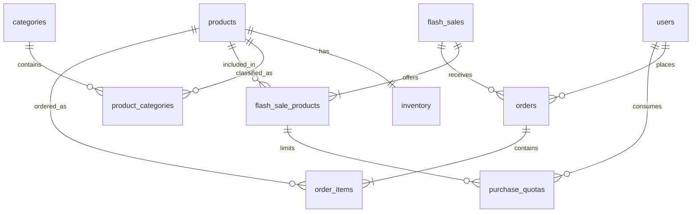

# High-Concurrency Limited Stock Ordering System — ER Diagram

> Status: Approved MVP database design for the portfolio application.
>
> Database: SQL Server. Data access uses Dapper, and the purchase write path is implemented through a stored procedure. The application does not connect to a payment gateway; the Purchase page only presents an order confirmation before the order request is submitted.

## Date and time policy

- Store application timestamps as UTC in `datetimeoffset` columns.
- Use `TODATETIMEOFFSET(SYSUTCDATETIME(), '+00:00')` for database-generated timestamps and `DateTimeOffset.UtcNow` in the application.
- Convert UTC to the user's timezone only when displaying a value in the UI.
- Flash-sale availability is determined from both its administrative `status` and its `starts_at`/`ends_at` window.
- `updated_at` remains `NULL` until a row is changed after creation unless a table explicitly requires a value.

## Diagram

---

## Table definitions

### `users`

Stores authenticated administrators and buyers. Disabled users remain in the database for order history and audit purposes but cannot submit new purchases.

| Column | Type | Key | Nullable | Default | Description |
| --- | --- | --- | --- | --- | --- |
| `user_id` | `uniqueidentifier` | PK | No | Application generated | Unique user identifier |
| `username` | `nvarchar(50)` | UK | No | — | Unique login name |
| `password_hash` | `nvarchar(255)` | — | No | — | Password hash produced by the authentication component |
| `first_name` | `nvarchar(50)` | — | No | — | User's first name |
| `last_name` | `nvarchar(50)` | — | No | — | User's last name |
| `role` | `varchar(20)` | — | No | `'Buyer'` | Authorization role: `Admin` or `Buyer` |
| `is_active` | `bit` | — | No | `1` | Whether the account may authenticate and purchase |
| `created_at` | `datetimeoffset` | — | No | UTC current time | UTC creation time |
| `updated_at` | `datetimeoffset` | — | Yes | `NULL` | UTC time of the latest update |

---

### `products`

Stores the product catalog. Stock is deliberately excluded from this table and exists only in `inventory`.

| Column | Type | Key | Nullable | Default | Description |
| --- | --- | --- | --- | --- | --- |
| `product_id` | `uniqueidentifier` | PK | No | Application generated | Unique product identifier |
| `sku` | `varchar(50)` | UK | No | — | Unique stock-keeping unit |
| `name` | `nvarchar(100)` | — | No | — | Product display name |
| `description` | `nvarchar(500)` | — | Yes | `NULL` | Short product description |
| `base_price` | `decimal(12,2)` | — | No | — | Normal catalog price |
| `is_active` | `bit` | — | No | `1` | Whether the product is available for use in the application |
| `created_at` | `datetimeoffset` | — | No | UTC current time | UTC creation time |
| `updated_at` | `datetimeoffset` | — | Yes | `NULL` | UTC time of the latest update |

---

### `categories`

Stores product categories used for browsing and filtering.

| Column | Type | Key | Nullable | Default | Description |
| --- | --- | --- | --- | --- | --- |
| `category_id` | `uniqueidentifier` | PK | No | Application generated | Unique category identifier |
| `name` | `nvarchar(50)` | UK | No | — | Unique category name |
| `is_active` | `bit` | — | No | `1` | Whether the category is visible and assignable |
| `created_at` | `datetimeoffset` | — | No | UTC current time | UTC creation time |
| `updated_at` | `datetimeoffset` | — | Yes | `NULL` | UTC time of the latest update |

---

### `product_categories`

Implements the many-to-many relationship between products and categories. Pricing does not belong in this table because a category assignment does not define a product price.

| Column | Type | Key | Nullable | Default | Description |
| --- | --- | --- | --- | --- | --- |
| `product_id` | `uniqueidentifier` | PK, FK → `products.product_id` | No | — | Assigned product |
| `category_id` | `uniqueidentifier` | PK, FK → `categories.category_id` | No | — | Assigned category |

The composite primary key is `(product_id, category_id)`.

---

### `inventory`

Stores the current sellable quantity for the MVP's single warehouse. This table is the only source of truth for stock; no stock quantity is duplicated in `products` or `flash_sale_products`.

| Column | Type | Key | Nullable | Default | Description |
| --- | --- | --- | --- | --- | --- |
| `product_id` | `uniqueidentifier` | PK, FK → `products.product_id` | No | — | Product whose stock is tracked |
| `available_quantity` | `int` | — | No | — | Quantity currently available for purchase |
| `row_version` | `rowversion` | — | No | Auto | Database-generated concurrency token |
| `updated_at` | `datetimeoffset` | — | No | UTC current time | UTC time of the latest stock change |

A separate stock identifier is unnecessary while the MVP has only one warehouse.

---

### `flash_sales`

Stores sale windows and their administrative lifecycle. A sale is purchasable only when its status is `Active` and the current UTC time is within its start and end timestamps.

| Column | Type | Key | Nullable | Default | Description |
| --- | --- | --- | --- | --- | --- |
| `flash_sale_id` | `uniqueidentifier` | PK | No | Application generated | Unique flash-sale identifier |
| `name` | `nvarchar(100)` | — | No | — | Sale display name |
| `starts_at` | `datetimeoffset` | — | No | — | Inclusive UTC start time |
| `ends_at` | `datetimeoffset` | — | No | — | Exclusive UTC end time |
| `status` | `varchar(20)` | — | No | — | `Draft`, `Active`, `Closed`, or `Cancelled` |
| `created_at` | `datetimeoffset` | — | No | UTC current time | UTC creation time |
| `updated_at` | `datetimeoffset` | — | Yes | `NULL` | UTC time of the latest update |

---

### `flash_sale_products`

Associates products with a flash sale and captures sale-specific price and buyer limit. The actual stock remains in `inventory`.

| Column | Type | Key | Nullable | Default | Description |
| --- | --- | --- | --- | --- | --- |
| `flash_sale_id` | `uniqueidentifier` | PK, FK → `flash_sales.flash_sale_id` | No | — | Flash sale containing the offer |
| `product_id` | `uniqueidentifier` | PK, FK → `products.product_id` | No | — | Product offered in the sale |
| `sale_price` | `decimal(12,2)` | — | No | — | Unit price captured by a successful order |
| `per_user_limit` | `int` | — | No | `10` | Maximum quantity one user may buy in this sale |

The composite primary key is `(flash_sale_id, product_id)`.

---

### `purchase_quotas`

Stores the quantity already purchased by each user for each flash-sale product. It is persistent business and audit data, not a cache. Quota, inventory, and order writes must commit or roll back together.

| Column | Type | Key | Nullable | Default | Description |
| --- | --- | --- | --- | --- | --- |
| `flash_sale_id` | `uniqueidentifier` | PK, composite FK | No | — | Flash sale containing the product |
| `product_id` | `uniqueidentifier` | PK, composite FK | No | — | Product whose quota is consumed |
| `user_id` | `uniqueidentifier` | PK, FK → `users.user_id` | No | — | Buyer consuming the quota |
| `purchased_quantity` | `int` | — | No | `0` | Total quantity successfully purchased |
| `updated_at` | `datetimeoffset` | — | No | UTC current time | UTC time of the latest quota change |

The composite primary key is `(flash_sale_id, product_id, user_id)`. The pair `(flash_sale_id, product_id)` is a composite foreign key to `flash_sale_products(flash_sale_id, product_id)`.

---

### `orders`

Stores confirmed order requests. There is no payment transaction in the MVP. The idempotency constraint makes retries return the existing logical result instead of creating another order.

| Column | Type | Key | Nullable | Default | Description |
| --- | --- | --- | --- | --- | --- |
| `order_id` | `uniqueidentifier` | PK | No | Application generated | Unique order identifier |
| `user_id` | `uniqueidentifier` | FK → `users.user_id` | No | — | Buyer who placed the order |
| `flash_sale_id` | `uniqueidentifier` | FK → `flash_sales.flash_sale_id` | No | — | Flash sale used by the order |
| `idempotency_key` | `varchar(100)` | UK with `user_id` | No | — | Client-generated request identifier |
| `status` | `varchar(20)` | — | No | — | `Pending`, `Completed`, `Cancelled`, or `Failed` |
| `total_amount` | `decimal(12,2)` | — | No | — | Sum of item quantity multiplied by captured unit price |
| `created_at` | `datetimeoffset` | — | No | UTC current time | UTC creation time |
| `updated_at` | `datetimeoffset` | — | Yes | `NULL` | UTC time of the latest update |

The unique constraint on `(user_id, idempotency_key)` is the database-level idempotency guarantee.

---

### `order_items`

Stores immutable purchase details, including the unit sale price captured when the order is created.

| Column | Type | Key | Nullable | Default | Description |
| --- | --- | --- | --- | --- | --- |
| `order_id` | `uniqueidentifier` | PK, FK → `orders.order_id` | No | — | Parent order |
| `product_id` | `uniqueidentifier` | PK, FK → `products.product_id` | No | — | Purchased product |
| `quantity` | `int` | — | No | — | Purchased quantity |
| `unit_price` | `decimal(12,2)` | — | No | — | Sale price captured at order creation |

The composite primary key is `(order_id, product_id)`. The purchase stored procedure validates that every item belongs to the flash sale recorded by its parent order.

---

## Constraints and indexes

### `users`

- Unique constraint on `username`.
- Check constraint: `role IN ('Admin', 'Buyer')`.
- Index on `(is_active, role)` for administrative user queries.

### `products`

- Unique constraint on `sku`.
- Check constraint: `base_price >= 0`.
- Index on `(is_active, name)` for product-list queries.

### `categories` and `product_categories`

- Unique constraint on `categories.name`.
- Composite primary key on `product_categories(product_id, category_id)` prevents duplicate assignments.
- Index on `product_categories(category_id, product_id)` supports category-to-product lookup; the primary key already supports product-to-category lookup.

### `inventory`

- Check constraint: `available_quantity >= 0`.
- `row_version` changes automatically whenever the inventory row is updated.
- Stock must be decremented with a guarded atomic update inside the purchase stored procedure; the check constraint is a final invariant, not the concurrency algorithm by itself.

### `flash_sales`

- Check constraint: `status IN ('Draft', 'Active', 'Closed', 'Cancelled')`.
- Check constraint: `ends_at > starts_at`.
- Index on `(status, starts_at, ends_at)` for locating current and upcoming sales.

### `flash_sale_products`

- Composite primary key on `(flash_sale_id, product_id)`.
- Check constraint: `sale_price >= 0`.
- Check constraint: `per_user_limit > 0`.
- Index on `(product_id, flash_sale_id)` supports product-to-sale lookup.

### `purchase_quotas`

- Composite primary key on `(flash_sale_id, product_id, user_id)`.
- Composite foreign key `(flash_sale_id, product_id)` → `flash_sale_products(flash_sale_id, product_id)`.
- Check constraint: `purchased_quantity >= 0`.
- Index on `(user_id, flash_sale_id, product_id)` supports buyer quota and purchase-history queries.

### `orders`

- Unique constraint on `(user_id, idempotency_key)`.
- Check constraint: `status IN ('Pending', 'Completed', 'Cancelled', 'Failed')`.
- Check constraint: `total_amount >= 0`.
- Index on `(user_id, created_at)` for buyer order history.
- Index on `(flash_sale_id, created_at)` for sale-level reporting and reconciliation.

### `order_items`

- Composite primary key on `(order_id, product_id)`.
- Check constraint: `quantity > 0`.
- Check constraint: `unit_price >= 0`.
- Index on `(product_id, order_id)` supports product-level order reporting.

SQL Server does not automatically create indexes for foreign keys, so the deployment script must create the reverse-lookup indexes listed above where the primary or unique key order does not already cover the query.
