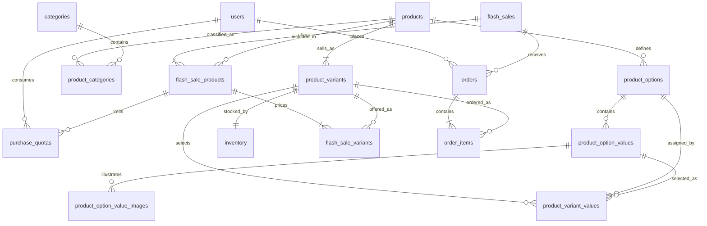

# High-Concurrency Limited Stock Ordering System — ER Diagram

> Status: Approved PostgreSQL MVP design with product options and variants.
>
> Data access uses Dapper. The purchase write path is implemented through a PostgreSQL function. The application does not connect to a payment gateway; the Purchase page only confirms the selected variant and quantity before submitting the order.

## Design principles

- A product is the catalog-level item shown to the customer.
- A product option describes a choice such as Color or Size.
- A product variant is the sellable SKU produced by one valid combination of option values.
- Price and stock belong to the variant, not the product or option value.
- A product without selectable options still receives one Default variant so every purchase follows the same path.
- Inventory is the only source of truth for available stock.
- Purchase quota is enforced at product level across all of its variants.
- Product images are stored outside PostgreSQL; products keep an optional catalog cover URL or object-storage key, while option-value image records provide variant galleries.

## Date and time policy

- Store application timestamps in PostgreSQL timestamptz columns.
- Keep the database and application sessions in UTC.
- Use CURRENT_TIMESTAMP for database-generated timestamps and DateTimeOffset.UtcNow in the application.
- Convert UTC to the user's timezone only when displaying a value.
- Flash-sale availability is determined from both its administrative status and starts_at/ends_at window.
- updated_at remains NULL until a row is changed after creation unless a table explicitly requires a value.

## Diagram



## Table definitions

### users

Stores authenticated administrators and buyers. Disabled users remain available for order history and audit but cannot submit new purchases.

| Column | PostgreSQL type | Key | Nullable | Default | Description |
| --- | --- | --- | --- | --- | --- |
| user_id | uuid | PK | No | Application generated | Unique user identifier |
| username | varchar(50) | UK | No | — | Unique login name |
| password_hash | varchar(255) | — | No | — | Password hash |
| first_name | varchar(50) | — | No | — | User's first name |
| last_name | varchar(50) | — | No | — | User's last name |
| role | varchar(20) | — | No | Buyer | Admin or Buyer |
| is_active | boolean | — | No | true | Whether the account may authenticate and purchase |
| created_at | timestamptz | — | No | CURRENT_TIMESTAMP | Creation time |
| updated_at | timestamptz | — | Yes | NULL | Latest update time |

### products

Stores catalog-level product information. SKU, normal price, and stock are deliberately excluded because they belong to product variants.

| Column | PostgreSQL type | Key | Nullable | Default | Description |
| --- | --- | --- | --- | --- | --- |
| product_id | uuid | PK | No | Application generated | Unique product identifier |
| name | varchar(100) | — | No | — | Product display name |
| description | varchar(500) | — | Yes | NULL | Short product description |
| image_url | text | — | Yes | NULL | Catalog cover image URL, local path, or object-storage key |
| is_active | boolean | — | No | true | Whether the product is visible and usable |
| created_at | timestamptz | — | No | CURRENT_TIMESTAMP | Creation time |
| updated_at | timestamptz | — | Yes | NULL | Latest update time |

### categories

| Column | PostgreSQL type | Key | Nullable | Default | Description |
| --- | --- | --- | --- | --- | --- |
| category_id | uuid | PK | No | Application generated | Unique category identifier |
| name | varchar(50) | UK | No | — | Unique category name |
| is_active | boolean | — | No | true | Whether the category is visible |
| created_at | timestamptz | — | No | CURRENT_TIMESTAMP | Creation time |
| updated_at | timestamptz | — | Yes | NULL | Latest update time |

### product_categories

| Column | PostgreSQL type | Key | Nullable | Default | Description |
| --- | --- | --- | --- | --- | --- |
| product_id | uuid | PK, FK → products.product_id | No | — | Assigned product |
| category_id | uuid | PK, FK → categories.category_id | No | — | Assigned category |

The composite primary key is (product_id, category_id).

### product_options

Defines the choices available for a product, such as Color and Size.

| Column | PostgreSQL type | Key | Nullable | Default | Description |
| --- | --- | --- | --- | --- | --- |
| option_id | uuid | PK | No | Application generated | Unique option identifier |
| product_id | uuid | FK → products.product_id | No | — | Product owning the option |
| name | varchar(50) | UK with product_id | No | — | Option name, such as Color |
| display_order | integer | — | No | 0 | UI ordering |
| is_required | boolean | — | No | true | Whether a variant must select this option |

Unique keys:

- (product_id, name)
- (product_id, option_id), used by composite foreign keys

### product_option_values

Stores the values belonging to an option, such as Black, Navy, S, and M.

| Column | PostgreSQL type | Key | Nullable | Default | Description |
| --- | --- | --- | --- | --- | --- |
| option_value_id | uuid | PK | No | Application generated | Unique value identifier |
| option_id | uuid | FK → product_options.option_id | No | — | Parent option |
| value | varchar(50) | UK with option_id | No | — | Display value |
| swatch_hex | varchar(7) | — | Yes | NULL | Optional color swatch such as #171717 |
| display_order | integer | — | No | 0 | UI ordering |
| is_active | boolean | — | No | true | Whether the value may be selected |

Unique keys:

- (option_id, value)
- (option_id, option_value_id), used by composite foreign keys

### product_option_value_images

Stores image references for an option value. This is useful when all sizes of one color share the same gallery.

| Column | PostgreSQL type | Key | Nullable | Default | Description |
| --- | --- | --- | --- | --- | --- |
| image_id | uuid | PK | No | Application generated | Unique image identifier |
| option_value_id | uuid | FK → product_option_values.option_value_id | No | — | Option value represented by the image |
| image_url | text | — | No | — | CDN URL or object-storage key |
| alt_text | varchar(200) | — | Yes | NULL | Accessible image description |
| display_order | integer | — | No | 0 | Gallery ordering |
| is_primary | boolean | — | No | false | Primary image for the value |

A partial unique index on option_value_id where is_primary is true permits at most one primary image per option value.

### product_variants

Stores each sellable SKU. A product without options must still have one Default variant.

| Column | PostgreSQL type | Key | Nullable | Default | Description |
| --- | --- | --- | --- | --- | --- |
| variant_id | uuid | PK | No | Application generated | Unique variant identifier |
| product_id | uuid | FK → products.product_id | No | — | Parent product |
| sku | varchar(50) | UK | No | — | Unique sellable SKU |
| base_price | numeric(12,2) | — | No | — | Normal variant price |
| combination_key | varchar(300) | UK with product_id | No | — | Canonical option combination |
| is_active | boolean | — | No | true | Whether the variant may be sold |
| created_at | timestamptz | — | No | CURRENT_TIMESTAMP | Creation time |
| updated_at | timestamptz | — | Yes | NULL | Latest update time |

For example, a canonical combination key may be color=black|size=m. The application must build it in stable option order.

Unique keys:

- sku
- (product_id, combination_key)
- (product_id, variant_id), used by composite foreign keys

### product_variant_values

Connects a variant to one selected value for each option.

| Column | PostgreSQL type | Key | Nullable | Default | Description |
| --- | --- | --- | --- | --- | --- |
| product_id | uuid | Composite FK | No | — | Product owning both the variant and option |
| variant_id | uuid | PK, composite FK | No | — | Variant being described |
| option_id | uuid | PK, composite FK | No | — | Selected option |
| option_value_id | uuid | Composite FK | No | — | Selected value |

The primary key is (variant_id, option_id), so a variant can select only one value for each option.

Composite foreign keys:

- (product_id, variant_id) → product_variants(product_id, variant_id)
- (product_id, option_id) → product_options(product_id, option_id)
- (option_id, option_value_id) → product_option_values(option_id, option_value_id)

These constraints prevent a variant from selecting an option or value belonging to another product.

### inventory

Stores sellable stock per variant. This is the only source of truth for stock.

| Column | PostgreSQL type | Key | Nullable | Default | Description |
| --- | --- | --- | --- | --- | --- |
| variant_id | uuid | PK, FK → product_variants.variant_id | No | — | Variant whose stock is tracked |
| available_quantity | integer | — | No | 0 | Quantity available for purchase |
| row_version | bigint | — | No | 0 | Explicit optimistic concurrency version |
| updated_at | timestamptz | — | No | CURRENT_TIMESTAMP | Latest stock change |

row_version is incremented by each successful stock update. It is an explicit PostgreSQL column and is not SQL Server rowversion.

### flash_sales

| Column | PostgreSQL type | Key | Nullable | Default | Description |
| --- | --- | --- | --- | --- | --- |
| flash_sale_id | uuid | PK | No | Application generated | Unique flash-sale identifier |
| name | varchar(100) | — | No | — | Sale display name |
| starts_at | timestamptz | — | No | — | Inclusive start time |
| ends_at | timestamptz | — | No | — | Exclusive end time |
| status | varchar(20) | — | No | Draft | Draft, Active, Closed, or Cancelled |
| created_at | timestamptz | — | No | CURRENT_TIMESTAMP | Creation time |
| updated_at | timestamptz | — | Yes | NULL | Latest update time |

### flash_sale_products

Includes a product in a sale and defines the buyer limit across all of that product's variants.

| Column | PostgreSQL type | Key | Nullable | Default | Description |
| --- | --- | --- | --- | --- | --- |
| flash_sale_id | uuid | PK, FK → flash_sales.flash_sale_id | No | — | Parent flash sale |
| product_id | uuid | PK, FK → products.product_id | No | — | Product offered in the sale |
| per_user_limit | integer | — | No | 10 | Maximum total quantity per user across all variants |

The primary key is (flash_sale_id, product_id).

### flash_sale_variants

Enables individual variants and captures their sale prices.

| Column | PostgreSQL type | Key | Nullable | Default | Description |
| --- | --- | --- | --- | --- | --- |
| flash_sale_id | uuid | PK, composite FK | No | — | Parent flash sale |
| product_id | uuid | Composite FK | No | — | Parent product |
| variant_id | uuid | PK, composite FK | No | — | Variant offered in the sale |
| sale_price | numeric(12,2) | — | No | — | Variant sale price |

The primary key is (flash_sale_id, variant_id).

Composite foreign keys:

- (flash_sale_id, product_id) → flash_sale_products(flash_sale_id, product_id)
- (product_id, variant_id) → product_variants(product_id, variant_id)

### purchase_quotas

Stores total purchased quantity at product level, so purchases of different colors and sizes consume the same limit.

| Column | PostgreSQL type | Key | Nullable | Default | Description |
| --- | --- | --- | --- | --- | --- |
| flash_sale_id | uuid | PK, composite FK | No | — | Flash sale |
| product_id | uuid | PK, composite FK | No | — | Product whose quota is consumed |
| user_id | uuid | PK, FK → users.user_id | No | — | Buyer |
| purchased_quantity | integer | — | No | 0 | Total purchased across all variants |
| updated_at | timestamptz | — | No | CURRENT_TIMESTAMP | Latest quota change |

The primary key is (flash_sale_id, product_id, user_id). The pair (flash_sale_id, product_id) references flash_sale_products.

### orders

Stores confirmed Regular and FlashSale order requests. There is no payment transaction in the MVP.

| Column | PostgreSQL type | Key | Nullable | Default | Description |
| --- | --- | --- | --- | --- | --- |
| order_id | uuid | PK | No | Application generated | Unique order identifier |
| user_id | uuid | FK → users.user_id | No | — | Buyer |
| order_type | varchar(20) | — | No | Regular | Regular or FlashSale |
| flash_sale_id | uuid | FK → flash_sales.flash_sale_id | Yes | NULL | Required only for a FlashSale order |
| idempotency_key | varchar(100) | UK with user_id | No | — | Client-generated request identifier |
| status | varchar(20) | — | No | Pending | Pending, Completed, Cancelled, or Failed |
| total_amount | numeric(12,2) | — | No | — | Sum of item quantity multiplied by captured price |
| created_at | timestamptz | — | No | CURRENT_TIMESTAMP | Creation time |
| updated_at | timestamptz | — | Yes | NULL | Latest update time |

The unique constraint on (user_id, idempotency_key) provides database-level idempotency.

### order_items

Stores immutable variant details and display snapshots captured at purchase time.

| Column | PostgreSQL type | Key | Nullable | Default | Description |
| --- | --- | --- | --- | --- | --- |
| order_id | uuid | PK, FK → orders.order_id | No | — | Parent order |
| variant_id | uuid | PK, FK → product_variants.variant_id | No | — | Purchased variant |
| quantity | integer | — | No | — | Purchased quantity |
| unit_price | numeric(12,2) | — | No | — | Sale price captured at purchase |
| sku_snapshot | varchar(50) | — | No | — | SKU at purchase time |
| product_name_snapshot | varchar(100) | — | No | — | Product name at purchase time |
| option_summary_snapshot | varchar(200) | — | No | — | Display text such as Color: Black, Size: M |

The primary key is (order_id, variant_id).

## Constraints and indexes

### Users and catalog

- users.username is unique.
- users.role must be Admin or Buyer.
- products and categories use is_active instead of physical deletion.
- categories.name is unique.
- product_categories has primary key (product_id, category_id).
- Add an index on product_categories(category_id, product_id).

### Options and variants

- product_options has unique (product_id, name).
- product_option_values has unique (option_id, value).
- product_option_values.swatch_hex is NULL or matches #[0-9A-Fa-f]{6}.
- product_variants.sku is unique.
- product_variants.base_price must be greater than or equal to zero.
- product_variants has unique (product_id, combination_key).
- product_variant_values has primary key (variant_id, option_id).
- Add an index on product_variant_values(option_value_id, variant_id).
- Add a partial unique index on product_option_value_images(option_value_id) where is_primary is true.

### Inventory

- inventory.available_quantity must be greater than or equal to zero.
- inventory.row_version must be greater than or equal to zero.
- Stock is decremented through a guarded atomic update by variant_id.
- A successful stock update increments row_version and returns the committed available quantity.

### Flash sales and quota

- flash_sales.status must be Draft, Active, Closed, or Cancelled.
- flash_sales.ends_at must be greater than starts_at.
- Add an index on flash_sales(status, starts_at, ends_at).
- flash_sale_products.per_user_limit must be greater than zero.
- flash_sale_variants.sale_price must be greater than or equal to zero.
- Add an index on flash_sale_variants(variant_id, flash_sale_id).
- purchase_quotas.purchased_quantity must be greater than or equal to zero.
- Add an index on purchase_quotas(user_id, flash_sale_id, product_id).

### Orders

- orders has unique (user_id, idempotency_key).
- orders.order_type must be Regular or FlashSale.
- Regular orders require flash_sale_id to be NULL; FlashSale orders require it to be non-NULL.
- orders.status must be Pending, Completed, Cancelled, or Failed.
- orders.total_amount must be greater than or equal to zero.
- order_items.quantity must be greater than zero.
- order_items.unit_price must be greater than or equal to zero.
- Add an index on orders(user_id, created_at).
- Add an index on orders(flash_sale_id, created_at).
- Add an index on order_items(variant_id, order_id).

PostgreSQL does not automatically create indexes on referencing foreign-key columns. Create the reverse-lookup indexes listed above where the primary or unique key order does not already cover the expected query.

## Purchase transaction boundary

The PostgreSQL purchase function receives the selected variant_id and order type, then performs all correctness checks in one transaction:

```text
Validate user and requested quantity
  → Load variant and parent product
  → Find or recognize (user_id, idempotency_key)
  → Resolve purchase rules
      → Regular: use product_variants.base_price
      → FlashSale: validate sale/product/variant, use sale_price, and validate quota
  → Atomically decrement variant inventory
  → Increment inventory row_version
  → Create order and variant order item
  → Commit or roll back all changes
```

The transaction must preserve these invariants:

- inventory.available_quantity never becomes negative.
- A user's product-level quota never exceeds flash_sale_products.per_user_limit for FlashSale orders.
- A successful order, order item, any applicable quota change, and variant stock decrement commit together.
- Retrying the same (user_id, idempotency_key) does not decrement stock or create another order.
- SignalR publishes only committed variant inventory values.

## Delete behavior

- Products, variants, users, flash sales, and orders referenced by purchase history use restricted deletion.
- Catalog availability is controlled with is_active.
- Removing a product-category assignment or an unused option image may use physical deletion.
- Variants referenced by order items must never be physically deleted.
- Closing or cancelling a flash sale does not restore inventory or delete completed orders automatically.
